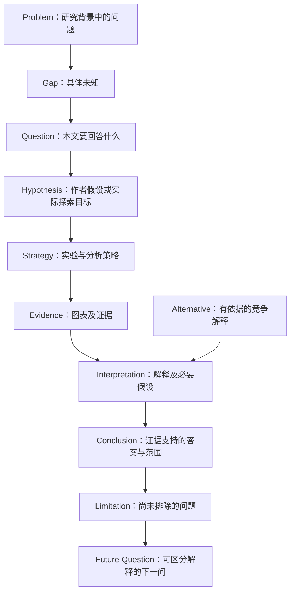

# {{论文标题}}：核心科研逻辑

<!-- 替换下图的通用节点文字为本文具体内容。不得把示例结构视作论文的真实证据。 -->

## 从问题到结论

图中箭头默认表示论证或信息关系，不自动表示生物学因果。支持关系标“支持”，设计关系标“检验”，未经验证的机制联系使用虚线并标“待验证”。假设为分析者重建时在节点注明。没有假设的探索性研究用实际目标替代。

## 关键实验和 Figure 对应

| 问题/预测 | 实验与对照 | Figure/panel 及来源 | 观察成为证据的依据 | 支持的 claim | 限制或竞争解释 |
| --- | --- | --- | --- | --- | --- |

按真实实验添加分支和汇合，不能从 knockout 的效应直接画出“直接调控”，也不能把一次预测吻合简写为“模型有效”。必要时为一条关键链另画图，保留未解决的分支。

## 定量模型在论证中的作用（实际存在时）

用本文内容连接“测量 → 建模假设 → 状态/观测模型 → 拟合 → 可比较预测 → 独立验证或待验证 → 生物学解释”。可注明读模型所需前置概念，完整推导链接 `01_论文深度解读.md`。

## 仍不能跨过的推理步骤

说明哪条箭头依赖额外假设、哪项证据尚未提供、哪个未来实验能够区分解释。与深读文档的结论强度和来源状态保持一致。

<!-- Mermaid 使用稳定 ASCII 节点 ID 与带引号的中文标签；不嵌套方括号，不把 end 用作裸 ID。生成后检查节点、边、引号及代码围栏；有渲染器则渲染核对，没有时明确仅检查语法结构。 -->
